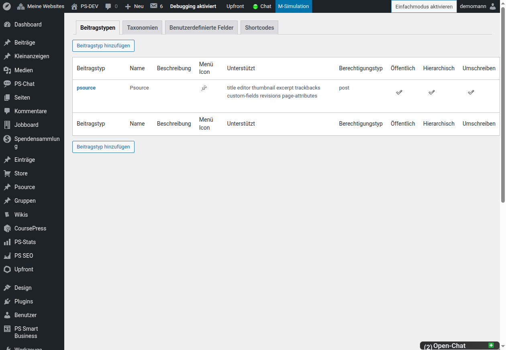

# CustomPress-Dokumentation

CustomPress erweitert ClassicPress um eigene Beitragstypen, Taxonomien und
benutzerdefinierte Felder. Diese Dokumentation beschreibt die Bedienung in
einer deutschsprachigen ClassicPress-Administration.

## Inhalte

1. [Inhaltstypen erstellen und verwalten](inhaltstypen.md)
2. [Anzeige, Shortcodes und Multisite](konfiguration.md)

## Voraussetzungen

- ClassicPress 2.7 oder neuer
- PHP 8.0 oder neuer
- Ein Benutzerkonto mit der Berechtigung, Plugins und Inhaltstypen zu
  verwalten

> **Hinweis:** Systemnamen von Beitragstypen und Taxonomien lassen sich nach
> dem Anlegen nicht ändern. Plane sie deshalb vor dem ersten Speichern.

## Oberfläche

## Installation und Einstieg

1. Kopiere den Ordner `custompress` nach
   `wp-content/plugins/custompress/` oder lade ihn über **Plugins →
   Installieren** hoch.
2. Öffne **Plugins → Installierte Plugins** und aktiviere **CustomPress**.
3. Öffne **CustomPress → Inhaltstypen**.

In einer Single-Site-Installation ist CustomPress danach sofort für diese
Website verfügbar. Hinweise zur Netzwerkaktivierung enthält
[Anzeige, Shortcodes und Multisite](konfiguration.md).

## Schnelleinstieg: Bücherverwaltung

Das folgende Beispiel erzeugt eine einfache Bücherverwaltung:

1. Lege den Beitragstyp `buch` mit den Bezeichnungen „Bücher“ und „Buch“ an.
2. Lege die Taxonomie `genre` an und ordne sie `buch` zu.
3. Lege das Feld „ISBN“ als Textfeld für `buch` an.
4. Erstelle unter **Bücher → Erstellen** einen ersten Eintrag.

## Systemnamen und sichtbare Bezeichnungen

CustomPress unterscheidet zwei Arten von Namen:

- **Systemname:** Technischer Schlüssel, etwa `buch` oder `genre`. Er darf nur
  Kleinbuchstaben, Zahlen und Unterstriche enthalten, muss mindestens zwei
  Zeichen lang sein und ist nach dem Speichern unveränderlich.
- **Labels:** Sichtbare Beschriftungen im Backend, etwa „Bücher“,
  „Buch hinzufügen“ und „Genres“. Hier sind Leerzeichen, Umlaute und eine
  natürliche deutsche Formulierung richtig.

Verwende für Systemnamen keine Umlaute, Leerzeichen oder Bindestriche. Für die
sichtbaren Labels sollen dagegen korrekte Umlaute verwendet werden.

## Oberfläche

Die zentrale Verwaltung befindet sich unter **CustomPress → Inhaltstypen**.
Dort sind die Reiter **Beitragstypen**, **Taxonomien**,
**Benutzerdefinierte Felder** und **Shortcodes** verfügbar.

