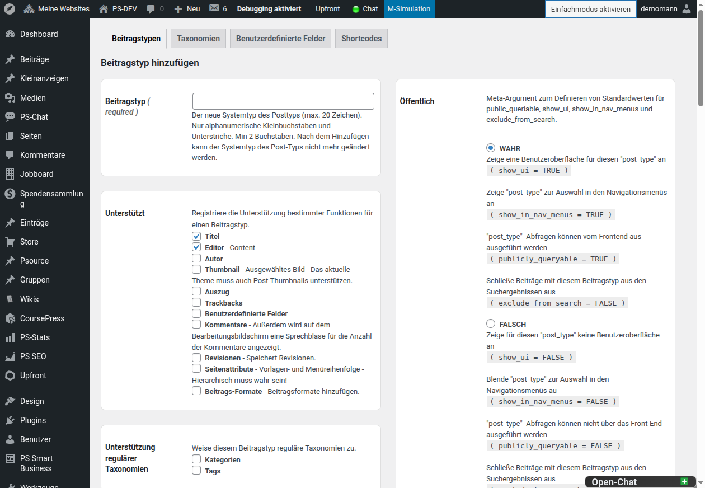
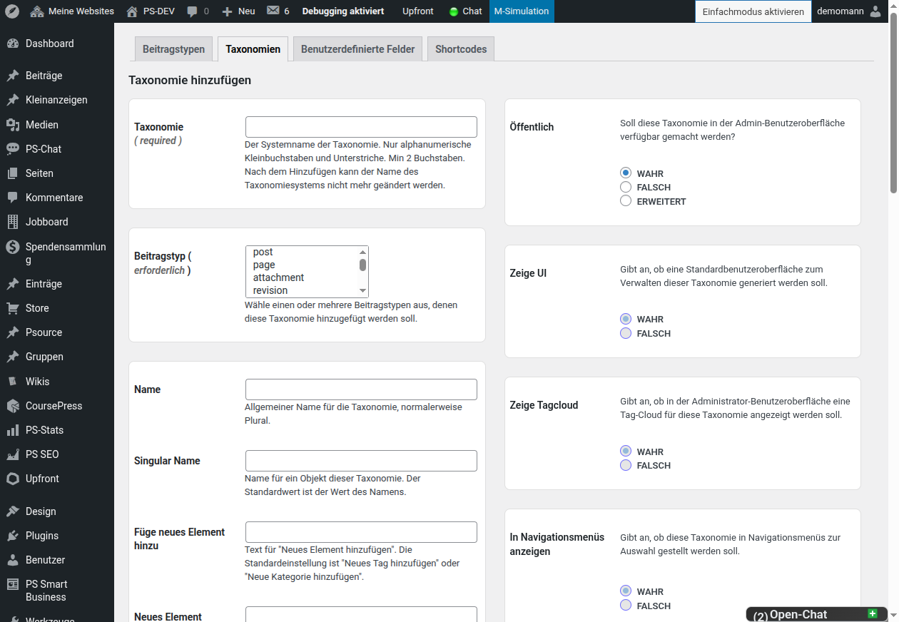
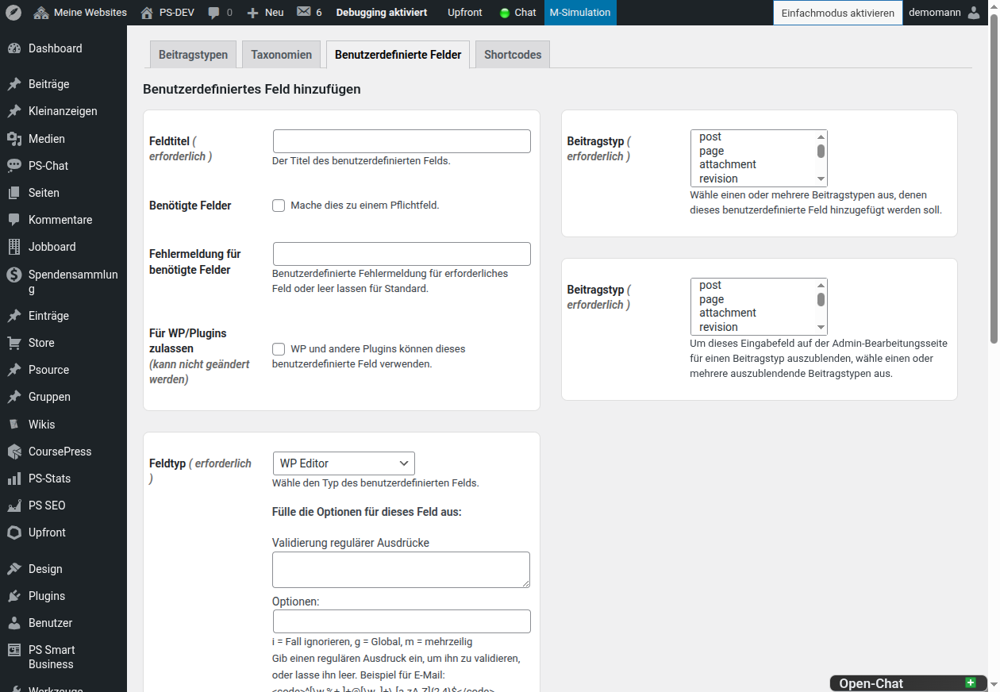

# Inhaltstypen erstellen und verwalten

Zurück zur [Dokumentationsübersicht](README.md).

## Beitragstypen

Ein Beitragstyp schafft einen eigenen Bereich für gleichartige Inhalte, zum
Beispiel Bücher, Immobilien, Veranstaltungen oder Rezensionen.

1. Öffne **CustomPress → Inhaltstypen**.
2. Bleibe im Reiter **Beitragstypen** und wähle **Beitragstyp hinzufügen**.
3. Trage einen dauerhaften Systemnamen ein, zum Beispiel `buch`.
4. Wähle im Abschnitt **Unterstützt**, welche Eingabefelder der
   Bearbeitungsbildschirm bereitstellen soll.
5. Aktiviere unter **Unterstützung regulärer Taxonomien** bei Bedarf
   **Kategorien** und/oder **Tags**.
6. Ergänze die Labels, etwa „Bücher“ als Name und „Buch“ als Singular.
7. Prüfe die öffentlichen Eigenschaften, die Umschreibung und gegebenenfalls
   die Archivoptionen.
8. Speichere den Beitragstyp mit **Beitragstyp hinzufügen**.

Danach erscheint der Beitragstyp als eigener Menüpunkt im ClassicPress-Backend.

Für übliche redaktionelle Inhalte sind meist **Titel**, **Editor**,
**Auszug**, **Thumbnail** und **Revisionen** sinnvoll. Aktiviere
**Seitenattribute** nur für hierarchische Beitragstypen; diese Option steuert
Vorlagen und die Menüreihenfolge.

## Taxonomien

Taxonomien gruppieren und klassifizieren Inhalte. Kategorien und Tags sind
eingebaute Taxonomien; mit CustomPress lassen sich eigene Taxonomien wie
„Genres“, „Autoren“ oder „Standorte“ anlegen.

1. Öffne **CustomPress → Inhaltstypen → Taxonomien**.
2. Wähle **Taxonomie hinzufügen**.
3. Gib einen technischen Namen ein, zum Beispiel `genre`.
4. Wähle unter **Beitragstyp** einen oder mehrere Beitragstypen, etwa `buch`.
5. Ergänze die sichtbaren Labels, beispielsweise „Genres“ und „Genre“.
6. Lege fest, ob die Taxonomie hierarchisch sein soll, und speichere sie.

Hierarchische Taxonomien eignen sich für Ober- und Unterbegriffe, etwa
„Genre → Belletristik → Krimi“. Nicht hierarchische Taxonomien eignen sich
für gleichrangige Stichwörter wie Autoren oder Themen.

## Benutzerdefinierte Felder

Benutzerdefinierte Felder ergänzen einen Beitragstyp um strukturierte Angaben,
etwa ISBN, Erscheinungsdatum, Preis oder eine Datei.

1. Öffne **CustomPress → Inhaltstypen → Benutzerdefinierte Felder**.
2. Wähle **Benutzerdefiniertes Feld hinzufügen**.
3. Trage einen verständlichen **Feldtitel** ein, zum Beispiel „ISBN“.
4. Markiere das Feld nur dann als Pflichtfeld, wenn ein Beitrag ohne diese
   Angabe nicht sinnvoll gespeichert werden kann.
5. Wähle den passenden **Feldtyp** und die zugehörigen Beitragstypen.
6. Speichere das Feld.

Verfügbar sind unter anderem **WP Editor**, Textfelder, mehrzeilige Textfelder,
Radio Buttons, Checkboxen, Auswahllisten, **Datumsauswahl** und **Upload**.
Für Textfelder kann eine Prüfung über reguläre Ausdrücke eingerichtet werden;
ergänze dann eine verständliche Fehlermeldung. Die Datumsauswahl verwendet
Flatpickr und kann mit einem eigenen Datumsformat konfiguriert werden.
