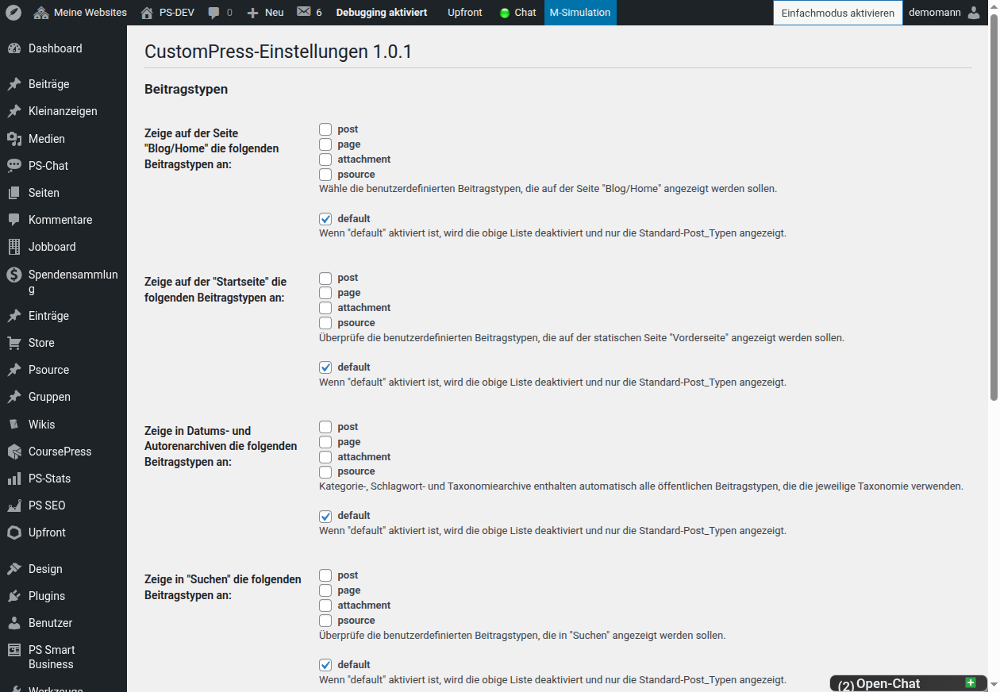

# Anzeige, Shortcodes und Multisite

Zurück zur [Dokumentationsübersicht](README.md).

## Anzeigeeinstellungen

Unter **CustomPress → Einstellungen** wird festgelegt, welche Beitragstypen
auf folgenden Ansichten erscheinen:

- Blog-/Home-Seite
- Statische Startseite
- Datums- und Autorenarchive
- Suche

Wähle die gewünschten Beitragstypen je Ansicht aus. Die Option `default`
belässt die jeweilige Ansicht bei den Standard-Beitragstypen und deaktiviert
die darüberliegende Auswahl.



## Kategorie-, Schlagwort- und Taxonomiearchive

Kategorie-, Schlagwort- und eigene Taxonomiearchive enthalten automatisch alle
öffentlichen Beitragstypen, die für die abgefragte Taxonomie registriert sind.
Das betrifft auch passende Beitragstypen anderer Plugins.

Beispiel: Unterstützen normale Beiträge und der Beitragstyp `buch` die
Kategorie „Neuheiten“, erscheinen beide auf dem Kategoriearchiv „Neuheiten“.
Die Seitennavigation berücksichtigt die gesamte Treffermenge. Eigene
Beitragstyparchive anderer Plugins werden dabei nicht verändert.

## Shortcodes und Theme-Ausgabe

Der Reiter **Shortcodes** in der Inhaltstypverwaltung zeigt die verfügbaren
Einbettungscodes. Für benutzerdefinierte Felder steht insbesondere der
Shortcode `ct` zur Verfügung:

```text
[ct id="_ct_isbn" property="value"]
```

Mögliche Eigenschaften sind unter anderem `value`, `title` und `description`.
Verwende Shortcodes für einzelne Beiträge oder Seiten. Für Archive, Widgets
und andere Schleifen ist eine Ausgabe im Theme zuverlässiger, weil ein
Shortcode dort nur den letzten Beitrag der Schleife ausgeben kann.

## Multisite

Dieser Abschnitt gilt nur für ClassicPress-Multisite. In einer
Single-Site-Installation werden Inhaltstypen direkt unter
**CustomPress → Inhaltstypen** verwaltet.

1. Melde dich als Superadministrator in der Netzwerkverwaltung an.
2. Öffne **Netzwerkverwaltung → Plugins** und aktiviere CustomPress über
   **Netzwerkweit aktivieren**.
3. Öffne **Netzwerkverwaltung → CustomPress → Einstellungen**.

In den Netzwerk-Einstellungen steuern zwei Optionen die Verwaltung:

- **Aktiviere Inhaltstypen für Unterwebseiten:** Unterwebsites dürfen eigene
  Inhaltstypen anlegen.
- **Netzwerkweite Inhaltstypen anzeigen:** Auf Netzwerkebene angelegte
  Inhaltstypen stehen den Unterwebsites zur Verfügung.

| Ziel | Inhaltstypen für Unterwebsites | Netzwerkweite Inhaltstypen anzeigen |
| --- | --- | --- |
| Einheitliche Typen im ganzen Netzwerk | Deaktiviert | Aktiv |
| Vollständig eigenständige Unterwebsites | Aktiviert | Deaktiviert |
| Gemeinsame Basis plus Ergänzungen je Unterwebsite | Aktiviert | Aktiv |

Ändere das Modell nicht unbedacht in einem produktiven Netzwerk. Prüfe vorher
auf einer Staging-Website, wie vorhandene Beitragstypen, Taxonomien und Felder
auf Unterwebsites angezeigt werden.
